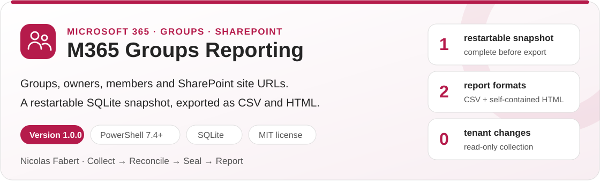
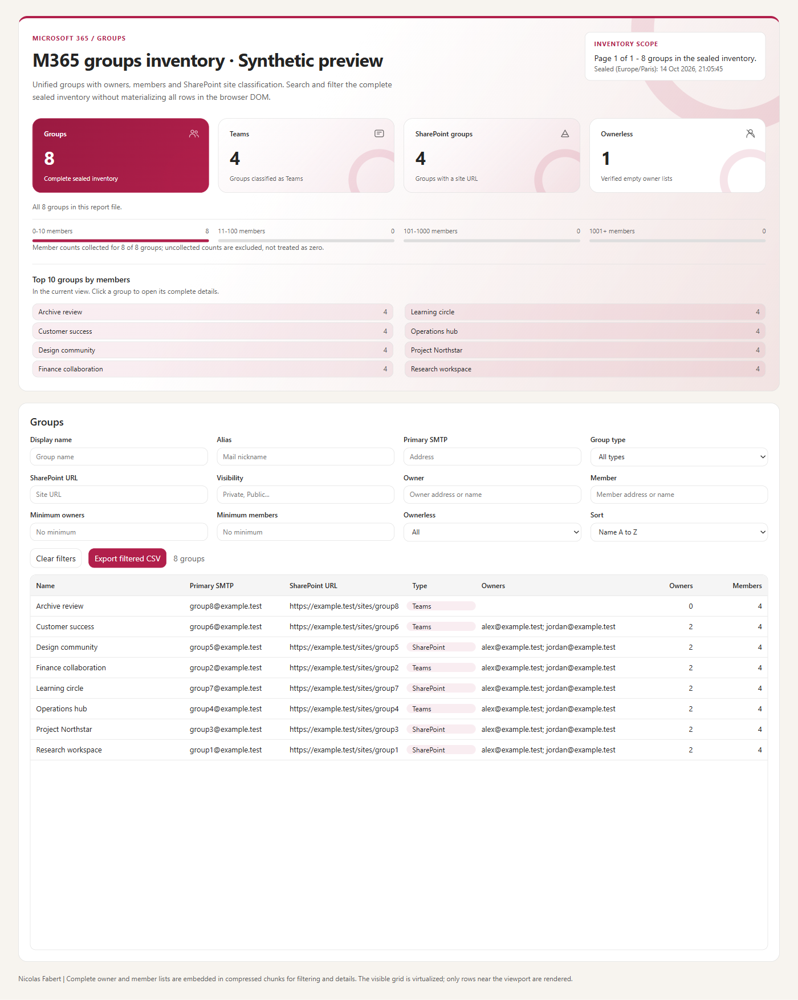
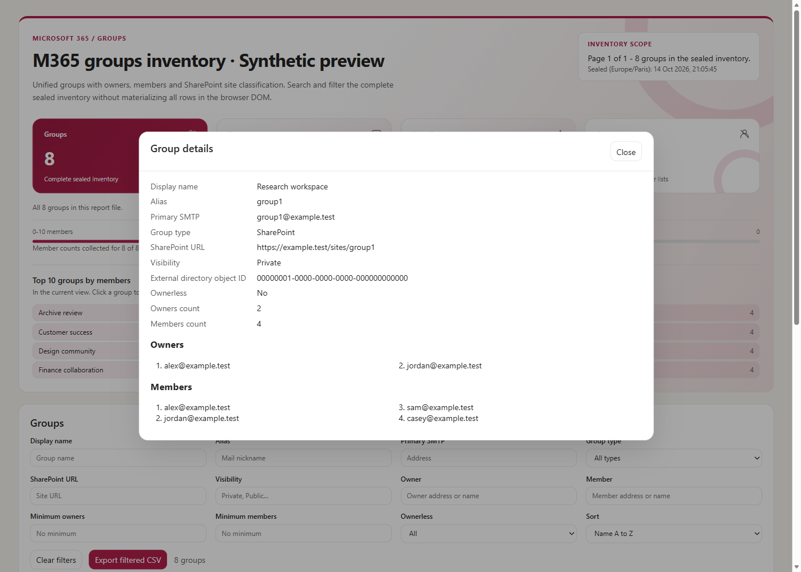

<p align="center">
  <picture>
    <source media="(prefers-color-scheme: dark)" srcset="docs/images/readme-banner-dark.svg">
    
  </picture>
</p>

<p align="center"><b>By Nicolas Fabert</b> &middot; Version 1.0.0 &middot; PowerShell 7.4+ &middot; MIT</p>
<p align="center">
  <a href="#why"><b>Why</b></a> &middot;
  <a href="#how-it-works"><b>How it works</b></a> &middot;
  <a href="#reports"><b>Reports</b></a> &middot;
  <a href="#quick-start"><b>Quick start</b></a> &middot;
  <a href="docs/GroupInventory-Guide.md"><b>Guide</b></a>
</p>

> [!IMPORTANT]
> This correction is a **signing preparation**, not an authenticated release. No release is published by this preparation. Use a reviewed, signed release ZIP for operational runs; the Git checkout is a source-development workspace.
>
> Review the publisher and trusted certificate chain before unblocking downloaded files. Follow your organization's execution policy; never disable signature or integrity checks to resolve an error.
>
> ```powershell
> Get-ChildItem "C:\Path\To\ExtractedPackage" -Recurse -File -Force | Unblock-File
> ```

## Why

Administrators need to know **which Microsoft 365 groups exist, who owns them, who belongs to them, and where their SharePoint site is**. This inventory gives them those facts without changing the tenant. Ownerless groups, Teams-backed groups and visibility are explicit, rather than hidden in an incomplete membership export.

## How it works

| Step | What happens |
|---|---|
| **Collect** | PowerShell reads Unified groups, owners and members from Microsoft Graph. A pre-collected `GroupId,Url` CSV supplies SharePoint URLs, or a separate SharePoint administrator session collects them. |
| **Keep a snapshot** | The offline .NET 8 engine streams pages into SQLite through a bounded writer. Checkpoints permit interrupted runs to resume without treating failed lists as empty. |
| **Reconcile and seal** | Every required source and relation list must complete. Failed requests, missing pages and reconciliation mismatches prevent sealing and final reports. |
| **Report** | A sealed snapshot becomes CSV and self-contained HTML. Re-export needs no Microsoft 365 connection. |

Microsoft 365 access is **read-only**. The tool does not change groups, memberships or tenant settings. A snapshot describes a collection interval, not a transactionally consistent instant.

## Reports

<table>
  <tr>
    <td width="50%" valign="top"><a href="docs/images/report-overview.png"></a><br><sub><b>Overview</b> &middot; counts, distributions, ranking, search and field filters</sub></td>
    <td width="50%" valign="top"><a href="docs/images/report-details.png"></a><br><sub><b>Group details</b> &middot; full owners and members, identity and SharePoint URL</sub></td>
  </tr>
</table>

These previews are rendered from **synthetic data only** (`example.test`), never tenant reports.

- **CSV**: UTF-8 with BOM, configurable delimiter, spreadsheet formula protection by default; `displayName`, `alias`, `primarySmtpAddress`, `groupType`, `sharePointUrl`, `visibility`, `externalDirectoryObjectId`, `owners`, `members`, `ownersCount`, `membersCount`, `ownerless`.
- **HTML**: light/dark themes, summary cards, distribution and rankings, search, inventory field and owner/member filters, sorting, virtual scrolling, group details and filtered CSV export. Full relation lists remain embedded even when the grid preview is capped.
- **Large inventories**: one self-contained compressed report by default; `-HtmlPartitioned` enables an index and part files. `-SkipMembers` means *not collected*, never a false zero.

## Requirements

| Item | Requirement |
|---|---|
| Runtime | Windows and PowerShell **7.4+** (.NET 8 orchestration); Windows PowerShell 5.1 cannot run the inventory engine |
| Authentication | Prefer a registered application certificate; external credential-file and environment-secret modes remain supported compatibility modes |
| Graph access | Consented read permissions for groups and the directory object types collected; see the [permission guide](docs/GroupInventory-Guide.md#3-authentication-and-permissions) |
| SharePoint URLs | Existing `GroupId,Url` CSV, or Windows PowerShell 5.1 with `Microsoft.Online.SharePoint.PowerShell` and a SharePoint administrator session |
| Dependencies | Engine and original SQLite binaries are bundled in the release ZIP; no .NET SDK is needed to run it |
| Development only | .NET SDK 8+ with a .NET 8 targeting pack or installed .NET 8 runtime, Pester 5+ and PSScriptAnalyzer |

## Quick start

### Get started: release ZIP

Download a reviewed release from [Releases](https://github.com/Nico77600/M365GroupsReporting/releases), extract it, review its signatures, then edit **only** the configuration. The pending candidate is not ready for this path.

```powershell
Set-Location C:\Tools\M365GroupsReporting
notepad .\config\M365GroupsReporting.config.psd1
.\Invoke-M365GroupsReporting.ps1 -SiteUrlsCsv C:\InventoryInput\siteurls.csv
.\Invoke-M365GroupsReporting.ps1 -ResumeRun .\data\run_YYYYMMDD_HHMMSS -NoRetention
```

The independent signed verifier authenticates the signed manifest **before parsing it**, checks every immutable raw SHA256 byte sequence (including the compiled engine DLL, native SQLite, templates, README and guides), and checks timestamped owner signatures. Missing, changed, untrusted or unexpected stable files fail **before assembly or native loading**. Expected owner signer: `0F28E442889F17B5F4D251E8F96E7CC6E2C9C6D6`.

The exact compatibility input names `siteurls.csv` and `app_creds.json` are mutable data, never executable authority or distributed assets. Prefer a protected credentials file outside the tool folder; unknown code or documentation is not exempt.

### Source development: not a release

The source layout stays at the root to preserve existing build and installation paths; packaging maps only approved files into the existing `lib\engine` runtime layout. There is no wholesale move of deployment directories.

```powershell
git clone https://github.com/Nico77600/M365GroupsReporting.git
Set-Location M365GroupsReporting
.\Build-Engine.ps1
.\Invoke-M365GroupsReporting.ps1 -SourceDevelopment -SiteUrlsCsv C:\InventoryInput\siteurls.csv
```

`-SourceDevelopment` is restricted to a Git source checkout containing the engine project and sources. It cannot run a packaged or pending artifact. It emits an explicit unauthenticated-development warning; it is not evidence of release authentication.

## Content

| Source item | Runtime purpose |
|---|---|
| `Invoke-M365GroupsReporting.ps1`, `Get-SiteUrls.ps1` | Inventory and optional SharePoint entry points |
| `Test-PackageIntegrity.ps1` | Independently authenticated runtime verifier |
| `config\` | Editable operational configuration, excluded from immutable hashes |
| `src\`, `engine\`, `Build-Engine.ps1` | Source development only; compiled output maps to runtime `lib\engine` |
| `templates\`, `docs\`, `lib\sqlite\` | Report template, guides and original SQLite dependencies |
| `tools\`, `tests\`, `.github\` | Development, offline tests and hosted validation; not shipped |

## Documentation

| Document | Content |
|---|---|
| **[Administrator and developer guide](docs/GroupInventory-Guide.md)** | Setup, every configuration field, authentication, permissions, collection/resume/retention, reports, development and the signing lifecycle |
| **[Self-contained HTML guide](docs/GroupInventory-Guide.html)** | The same guide, with light/dark themes, navigation and copy buttons; open locally |
| [Runtime README source](docs/runtime-README.md) | Copied as the package's `README.md`; release use, integrity boundary and contents |
| [Changelog](CHANGELOG.md) / [Provenance](PROVENANCE.md) | Reviewed change surface and precise limits of provenance claims |
| [Security](SECURITY.md) | Private vulnerability reporting and responsible disclosure |

## Tests

```powershell
.\Build-Engine.ps1
Invoke-Pester -Path .\tests -Output Detailed
.\tools\Build-Documentation.ps1
.\tools\New-GroupInventoryPackage.ps1 -Stage Prepare -Destination C:\ReviewedArtifacts\M365GroupsReporting-1.0.0
```

All tests use synthetic offline data, never tenant credentials or lab runs. CI uses PowerShell 7 on a disposable Windows runner. PowerShell analysis execution and syntax must succeed; analyzer diagnostics and CodeQL findings are advisory. Hosted checks, actual native signatures, raw Git-byte signature verification and owner visual approval remain separate publication gates.

Preparation creates `.publication-pending` and an **unsigned** layout-correct manifest. After the owner signs the exact staged scripts, `-Stage RefreshManifest` hashes those finalized bytes; the owner then signs the manifest. `-Stage Finalize` independently verifies the package before removing the pending marker. No tool signs files, contacts a timestamp service or publishes GitHub content.

## License

[MIT](LICENSE), copyright 2026 Nicolas Fabert. Original bundled components retain their vendor bytes and licenses; see [THIRD-PARTY-NOTICES.md](THIRD-PARTY-NOTICES.md).

## Disclaimer

This Script is a Personal project.
It's provided "AS-IS". It's not an official Microsoft product so no support can be expected from Microsoft.

As any scripts you must read carefully the documentation and test it first in a Test environment before any run in Production.
